# Portfolio Website

The personal portfolio of **Artur Bomtempo**, a software engineer. It presents his _background_, _projects_, _talks_ and _published content_, and it gives recruiters, companies and the developer community a direct way to **get in touch**. Built with **Nuxt 4**, **Vue 3** and **Tailwind CSS v4**, the site is fully **prerendered**, available in **Portuguese, English and Spanish**, and designed for _performance_, _accessibility_, _SEO_ and _security_ from the start.

---

## 🚧 Project Status

[](https://www.arturbomtempo.dev)


[](LICENSE.md)


---

## 📚 Table of Contents

- [Useful Links](#-useful-links)
- [About the Project](#-about-the-project)
- [Main Features](#-main-features)
- [Tech Stack](#-tech-stack)
- [Architecture](#-architecture)
- [Getting Started](#-getting-started)
- [Deploy](#-deploy)
- [Project Structure](#-project-structure)
- [Screenshots](#-screenshots)
- [Quality Checks](#-quality-checks)
- [References](#-references)
- [Author](#-author)
- [Contributing](#-contributing)
- [License](#-license)

---

## 🔗 Useful Links

- **Live website:** [arturbomtempo.dev](https://www.arturbomtempo.dev) (Portuguese), [English](https://www.arturbomtempo.dev/en) and [Spanish](https://www.arturbomtempo.dev/es) versions.
- **Repository:** [github.com/arturbomtempo-dev/portfolio](https://github.com/arturbomtempo-dev/portfolio)

---

## 📝 About the Project

This repository holds the source code of Artur Bomtempo's personal website. It brings together, in a single place, his professional journey, the projects he has built, the talks, workshops and courses he has led and the articles, videos and newsletters he publishes.

The site started as a React and Vite single page application and was rewritten in **Nuxt 4** to solve the limits of client-side rendering. Every page is now delivered as ready HTML, which gives search engines and link previews complete content, makes the first load faster on mobile networks and gives each project its own shareable URL.

It is also a professional reference in itself: a small but complete production codebase with internationalization, accessibility, SEO, security headers and a documented architecture.

---

## ✨ Main Features

- **Three languages:** Portuguese (default), English and Spanish, each one with its own URL (`/`, `/en`, `/es`), translated metadata and `hreflang` alternates. Switching languages keeps the current page and scroll position.
- **Dark and light themes:** follows the operating system by default, remembers the visitor's choice and never flashes the wrong theme on load.
- **Animated home background:** real code snippets drift down behind the hero on a lightweight canvas, react to the mouse (they move aside and light up in the brand green), follow the dark and light themes, fade out behind the main text and pause when the page is not visible. It loads after the page, adds about 5 KB of JavaScript and stays still for visitors who prefer reduced motion.
- **Projects with detail pages:** every project has its own route (`/projects/<id>`) with description, technologies, links, a dedicated social preview image and, when there are screenshots, a gallery: a large stage with arrows, swipe and a counter, a strip of thumbnails and a full-screen viewer. Phone screenshots are shown whole, inside an iPhone frame drawn at build time.
- **Talks:** talks, workshops and courses on a vertical timeline grouped by year, with filters in the URL and a detail page per talk with its date, location, description, topics and a photo mosaic with a full-screen viewer (zoom, keyboard and swipe).
- **Content hub:** articles, videos and newsletters with filters stored in the URL (`/contents?type=video`), so a filtered view can be shared.
- **About page:** achievements (with the years of experience and the number of talks computed automatically), technologies, a live GitHub contribution graph, an education and career timeline with month-precision periods ordered automatically, and a testimonials carousel.
- **BLACKBOX:** the last item of the main navigation opens a CTF-style incident investigation in a realistic terminal: a virtual file system, logs to correlate, a tampered JWT to analyze, progressive hints, saved progress and a final skills report, in the three languages.
- **Contact form:** validated with Zod in the visitor's language and delivered by e-mail through FormSubmit, with a honeypot field against spam.
- **SEO:** prerendered HTML, canonical URLs, `hreflang` alternates, a sitemap per language, `robots.txt`, schema.org structured data (`Person` and `WebSite`) and Open Graph images per language, per project and per talk.
- **Performance:** AVIF and WebP images in the exact size each screen needs, self-hosted fonts and components loaded only when they are needed.
- **Accessibility:** semantic HTML, a logical heading order, keyboard navigation with visible focus and translated labels for screen readers.
- **Security:** a strict Content Security Policy (no inline scripts or event handlers), HSTS and other security headers on every response.
- **Custom error pages:** a translated 404 page with a real 404 status, also used for unknown projects and talks.

---

## 🧰 Tech Stack

### Front-end

| Concern              | Technology                                                                                       |
| :------------------- | :----------------------------------------------------------------------------------------------- |
| Framework            | [Nuxt 4](https://nuxt.com) and [Vue 3](https://vuejs.org) (`<script setup>`)                     |
| Language             | [TypeScript](https://www.typescriptlang.org)                                                     |
| Styling              | [Tailwind CSS v4](https://tailwindcss.com) and `tw-animate-css`                                  |
| Internationalization | [`@nuxtjs/i18n`](https://i18n.nuxtjs.org)                                                        |
| Theme                | [`@nuxtjs/color-mode`](https://color-mode.nuxtjs.org)                                            |
| Images and fonts     | [`@nuxt/image`](https://image.nuxt.com) and [`@nuxt/fonts`](https://fonts.nuxt.com)              |
| UI primitives        | [Reka UI](https://reka-ui.com) (dialogs) and [Embla Carousel](https://www.embla-carousel.com)    |
| Icons                | [Lucide](https://lucide.dev) and [Tabler Icons](https://tabler.io/icons) (brand logos)           |
| Forms                | [Zod](https://zod.dev) for validation and [vue-sonner](https://vue-sonner.vercel.app) for toasts |

### SEO and Security

- **Sitemap and robots:** [`@nuxtjs/sitemap`](https://nuxtseo.com/docs/sitemap) and [`@nuxtjs/robots`](https://nuxtseo.com/docs/robots)
- **Security headers:** [`nuxt-security`](https://nuxt-security.vercel.app)

### Infrastructure and Tooling

- **Hosting:** [Vercel](https://vercel.com), with prerendered pages, image optimization and a São Paulo region function
- **Contact form delivery:** [FormSubmit](https://formsubmit.co)
- **Code quality:** Prettier, `vue-tsc` and Vitest
- **Image pipeline:** [sharp](https://sharp.pixelplumbing.com), through the `images:prepare` script
- **Package manager:** npm

---

## 🧱 Architecture

The project follows the standard **Nuxt 4 directory structure**, with components grouped by the page or domain they belong to. It relies on Nuxt conventions (file-based routing, auto-imports and layouts) instead of a custom structure, so any Nuxt developer can find their way around and a new page never requires restructuring existing code.

Key decisions:

- **Static first:** every page is prerendered at build time in the three languages. Server functions only handle URLs that do not exist (a translated 404 with the correct status code) and the GitHub contribution graph, which is cached and refreshed every 6 hours.
- **Interface text and content are separate layers:** interface messages (buttons, headings, labels) live in `i18n/locales/<locale>.json`, while portfolio content (projects, timeline, testimonials, articles) lives in typed TypeScript files in `app/data/<module>/<locale>.ts`. TypeScript guarantees that the three translations always have the same structure.
- **Thin pages, focused components:** pages only set metadata and compose components. Each component lives in its own folder (`components/<module>/<ComponentName>/index.vue`), and generic building blocks live in `components/ui`.
- **Configuration in one place:** headers, security rules and rendering rules are declared in `nuxt.config.ts`, and Nitro translates them into the Vercel routing configuration.

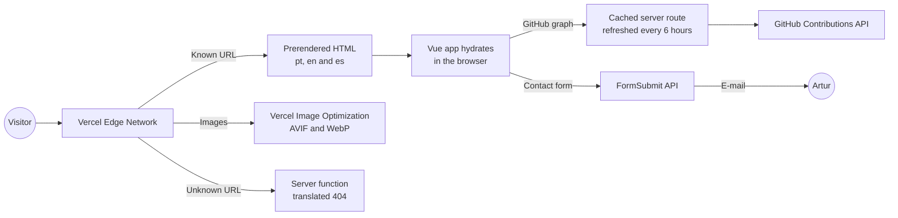

---

## 🔧 Getting Started

### Prerequisites

- **Node.js** 22 or newer
- **npm** 10 or newer

### Installation

```bash
git clone https://github.com/arturbomtempo-dev/portfolio.git
cd portfolio
npm install
```

### Running Locally

```bash
npm run dev
```

The site will be available at **http://localhost:3000**.

### Available Scripts

| Command                  | Description                                                                                       |
| :----------------------- | :------------------------------------------------------------------------------------------------ |
| `npm run dev`            | Starts the development server with hot reload.                                                    |
| `npm run build`          | Builds and prerenders the site for production.                                                    |
| `npm run generate`       | Generates a fully static version of the site.                                                     |
| `npm run preview`        | Serves the production build locally.                                                              |
| `npm run typecheck`      | Checks the types of the whole project.                                                            |
| `npm run format`         | Formats every file with Prettier.                                                                 |
| `npm test`               | Runs the unit tests (Vitest).                                                                     |
| `npm run images:prepare` | Converts new images to WebP, frames phone screenshots and creates missing project preview images. |

### Environment Variables

No environment variable is required: the defaults in `nuxt.config.ts` already point to the production values. The variables below only exist to override them, for example in a preview deployment. Create a `.env` file in the project root if you need any of them.

| Variable                            | Description                                                       | Default                                            |
| :---------------------------------- | :---------------------------------------------------------------- | :------------------------------------------------- |
| `NUXT_SITE_URL`                     | Public URL used by the sitemap, robots and social preview images. | `https://www.arturbomtempo.dev`                    |
| `NUXT_PUBLIC_I18N_BASE_URL`         | Base URL used for canonical and `hreflang` links.                 | `https://www.arturbomtempo.dev`                    |
| `NUXT_PUBLIC_CONTACT_FORM_ENDPOINT` | FormSubmit endpoint that receives the contact form messages.      | `https://formsubmit.co/ajax/arturbcolen@gmail.com` |

To test the contact form without sending real e-mails, point `NUXT_PUBLIC_CONTACT_FORM_ENDPOINT` to an address on the reserved `example.com` domain:

```bash
NUXT_PUBLIC_CONTACT_FORM_ENDPOINT=https://formsubmit.co/ajax/test@example.com
```

### Running the Production Build Locally

```bash
npm run build
node .output/server/index.mjs
```

---

## 🚀 Deploy

The site is deployed on **Vercel**, and the build settings are pinned in [`vercel.json`](vercel.json).

1. Import the repository in Vercel with the default settings. The framework, install command (`npm ci`) and build command (`npm run build`) come from `vercel.json`.
2. Add the `www.arturbomtempo.dev` domain as the primary domain and redirect the apex domain to it.
3. Deploy. Nitro detects Vercel automatically and generates the prerendered pages, the image optimization settings and the security headers.

After each deploy, check one page in each language, a project page, a 404 page and the response headers, and send one real message through the contact form. The first message sent to a new FormSubmit address requires a one-time activation by e-mail.

---

## 📂 Project Structure

```
.
├── app/
│   ├── app.vue                  # Root component: global metadata and page key
│   ├── error.vue                # Translated error and 404 page
│   ├── assets/css/main.css      # Tailwind setup, design tokens and custom utilities
│   ├── components/
│   │   ├── blackbox/            # BLACKBOX terminal, prompt, output and final report
│   │   ├── about/               # About page sections (achievements, timeline, testimonials)
│   │   ├── contact/             # Contact form and social links
│   │   ├── contents/            # Content cards and listing
│   │   ├── talks/               # Talks timeline, cards, details and photo gallery
│   │   ├── home/                # Home hero section
│   │   ├── layout/              # Header, footer, theme toggle, language selector, toaster
│   │   ├── projects/            # Project cards, grid and details
│   │   └── ui/                  # Generic building blocks (buttons, cards, dialogs, form fields)
│   ├── composables/             # Shared logic (content per locale, forms, navigation)
│   ├── data/                    # Portfolio content in pt, en and es
│   ├── layouts/default.vue      # Page shell with header and footer
│   ├── middleware/              # Keeps the scroll position when the language changes
│   ├── pages/                   # File-based routes, one folder per page
│   ├── types/                   # Shared TypeScript types
│   └── utils/                   # Pure helper functions
├── i18n/locales/                # Interface messages in pt, en and es
├── modules/                     # Local Nuxt modules for build-level fixes
├── scripts/                     # Image pipeline: WebP conversion, iPhone frame and preview images
├── server/
│   ├── api/                     # Proxies and caches the GitHub contribution graph
│   └── plugins/                 # Cleans the rendered HTML for the Content Security Policy
├── shared/                      # Types and constants shared by the app and the server
├── public/
│   ├── images/                  # Optimized WebP images used by the pages
│   ├── og/                      # Social preview images per language, project and talk
│   └── ...                      # Favicons and web app manifest
├── resources/                   # Screenshots used in this README
├── test/                        # Unit tests (Vitest)
├── LICENSE.md                   # MIT license
├── nuxt.config.ts               # Nuxt, modules, security headers and rendering rules
└── vercel.json                  # Vercel build settings
```

---

## 📸 Screenshots

### Desktop

|                                                   Home                                                   |                                  Home (light theme)                                   |
| :------------------------------------------------------------------------------------------------------: | :-----------------------------------------------------------------------------------: |
|                       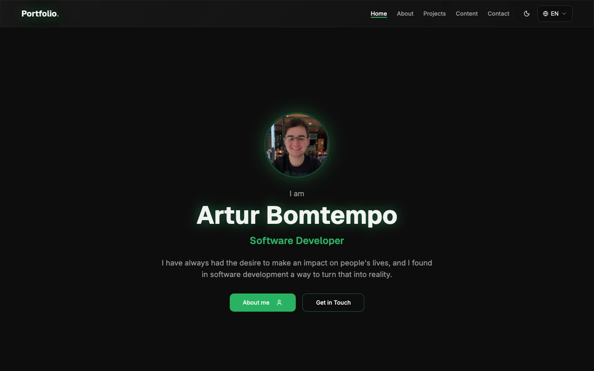                        |   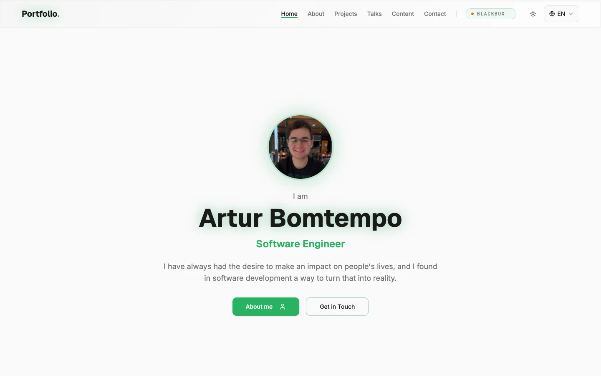    |
|                                                **About**                                                 |                                     **Projects**                                      |
|                      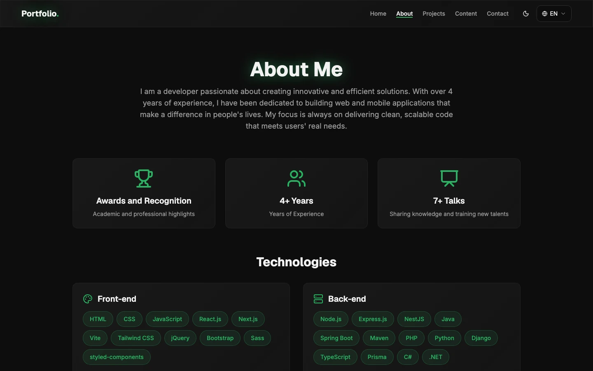                       |          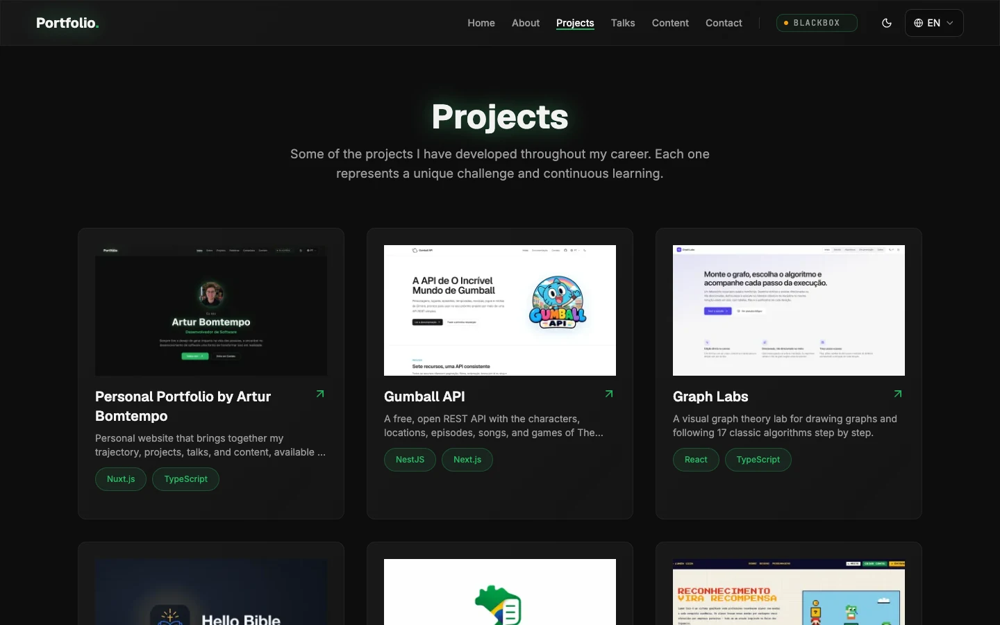          |
|                                           **Project details**                                            |                                       **Talks**                                       |
| 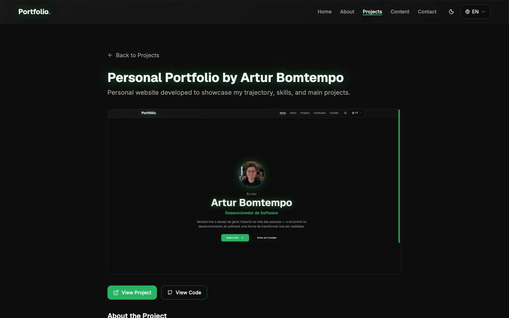 |           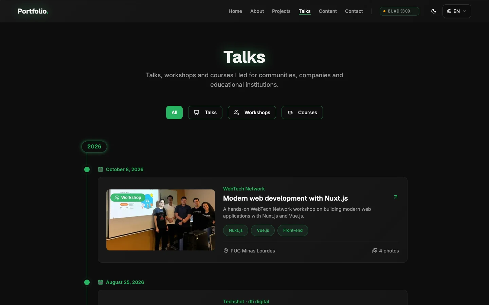           |
|                                             **Talk details**                                             |                                      **Content**                                      |
|               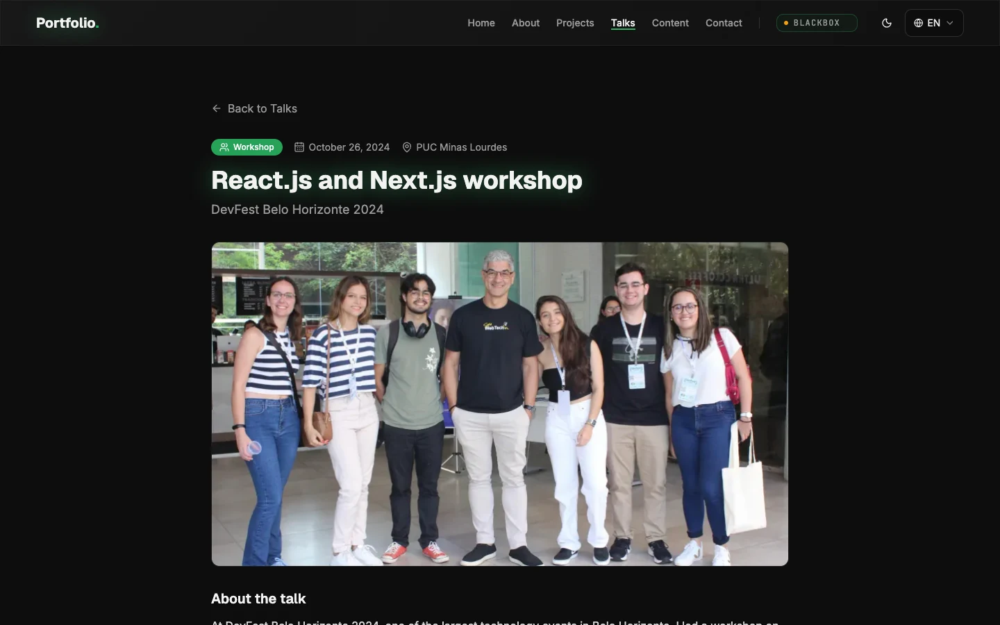                |          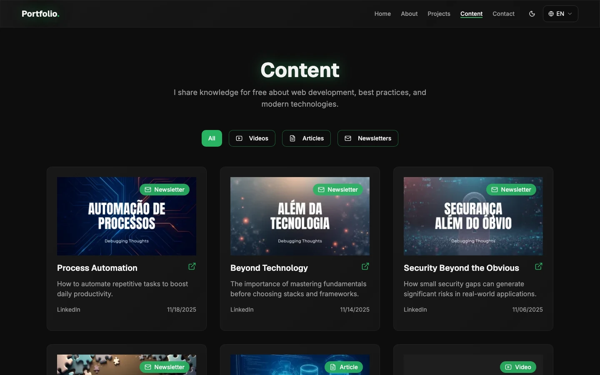           |
|                                               **Contact**                                                |                                     **BLACKBOX**                                      |
|                    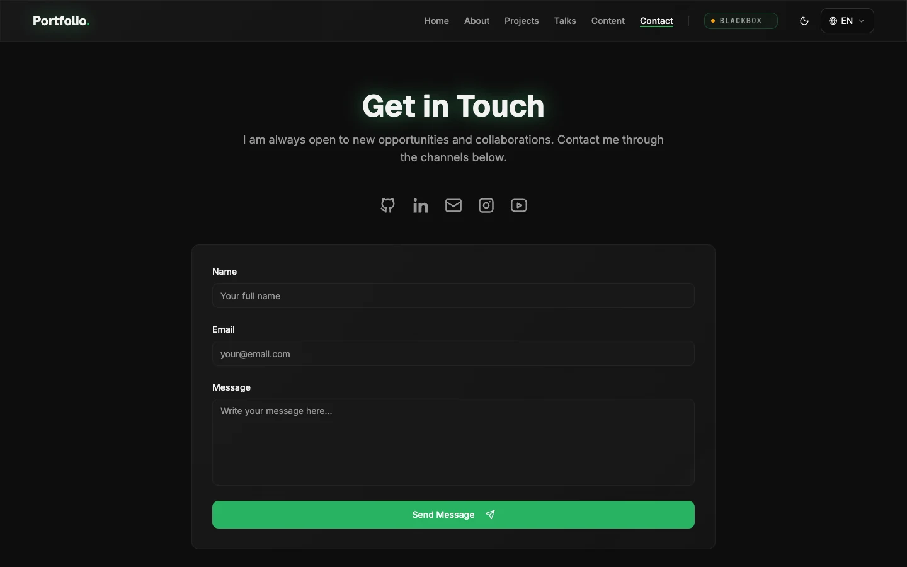                     | 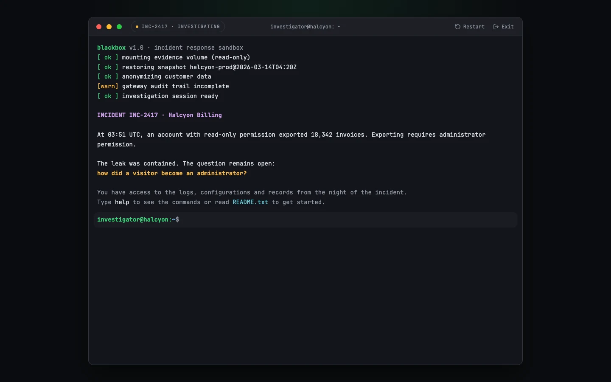 |

### Mobile

|                                     Home                                      |                                       Projects                                        |                                      Talks                                      |
| :---------------------------------------------------------------------------: | :-----------------------------------------------------------------------------------: | :-----------------------------------------------------------------------------: |
| 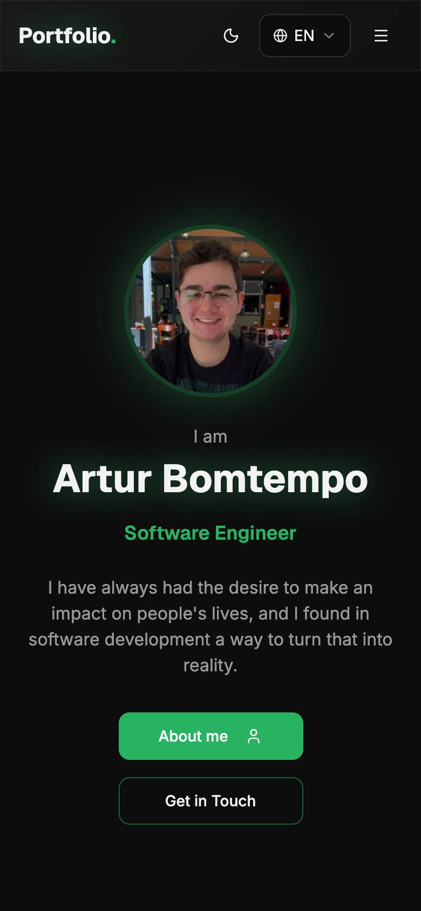 | 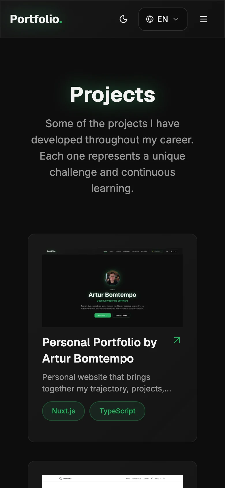 | 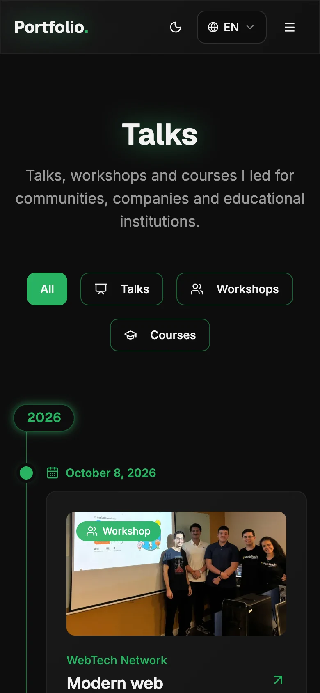 |

-------------------------------------------------------------------------------: | :------------------------------------------------------------------------------: |
|  |  |
| **About** | **Projects** |
|  |  |
| **Project details** | **Content** |
|  |  |
| **Contact** | |
|  | |

### Mobile

|                                     Home                                      |                                       Projects                                        |
| :---------------------------------------------------------------------------: | :-----------------------------------------------------------------------------------: |
|  |  |

---

## ✅ Quality Checks

Every change is validated with:

```bash
npm test
npm run typecheck
npx prettier --check .
npm run build
```

The unit tests cover the pure logic of the site:

- **BLACKBOX engine:** the virtual file system, JWT decoding and verification, answer validation in the three languages, progress restoration and a complete playthrough, including the paths that must not complete a challenge.
- **Galleries:** the talks mosaic (no holes in the grid for 1 to 16 photos), the project thumbnail strip and the rule that shows phone screenshots whole.
- **Content formatting:** talk dates and ranges, timeline periods and their order, rich text lists, years of experience and the structured data.
- **Home background:** how many snippets fit each screen, their movement, the reaction to the mouse and the quieter area behind the main text.

Before a release, the production build is also checked with Lighthouse (mobile and desktop) and with axe in both the dark and light themes.

---

## 📖 References

- [Nuxt documentation](https://nuxt.com/docs)
- [Vue.js documentation](https://vuejs.org/guide/introduction.html)
- [Tailwind CSS documentation](https://tailwindcss.com/docs)
- [Nuxt i18n documentation](https://i18n.nuxtjs.org/docs/getting-started)
- [Nuxt Image documentation](https://image.nuxt.com/get-started/installation)
- [Nuxt Security documentation](https://nuxt-security.vercel.app/getting-started/installation)
- [Nuxt on Vercel](https://vercel.com/docs/frameworks/full-stack/nuxt)
- [FormSubmit documentation](https://formsubmit.co/documentation)
- [Conventional Commits](https://www.conventionalcommits.org/en/v1.0.0/)

---

## 👤 Author

| Name                 | Photo                                                                                                                 | GitHub                                                                                                                                                                                            | LinkedIn                                                                                                                                                                                                   | Gmail                                                                                                                                                                                    |
| :------------------- | :-------------------------------------------------------------------------------------------------------------------- | :------------------------------------------------------------------------------------------------------------------------------------------------------------------------------------------------ | :--------------------------------------------------------------------------------------------------------------------------------------------------------------------------------------------------------- | :--------------------------------------------------------------------------------------------------------------------------------------------------------------------------------------- |
| Artur Bomtempo Colen | <div align="center"></div> | <div align="center"><a href="https://github.com/arturbomtempo-dev"></a></div> | <div align="center"><a href="https://www.linkedin.com/in/artur-bomtempo/"></a></div> | <div align="center"><a href="mailto:arturbcolen@gmail.com"></a></div> |

---

## 🤝 Contributing

This is a personal portfolio, but suggestions and bug reports are welcome.

1. Open an [issue](https://github.com/arturbomtempo-dev/portfolio/issues) describing the bug or the suggestion.
2. For code changes, fork the repository and create a branch (`git checkout -b fix/short-description`).
3. Keep the existing structure and code style, and run the [quality checks](#-quality-checks).
4. Commit using [Conventional Commits](https://www.conventionalcommits.org/en/v1.0.0/) (`git commit -m "fix: describe the change"`).
5. Push the branch and open a pull request.

---

## 📄 License

This project is distributed under the **[MIT License](LICENSE.md)**.
